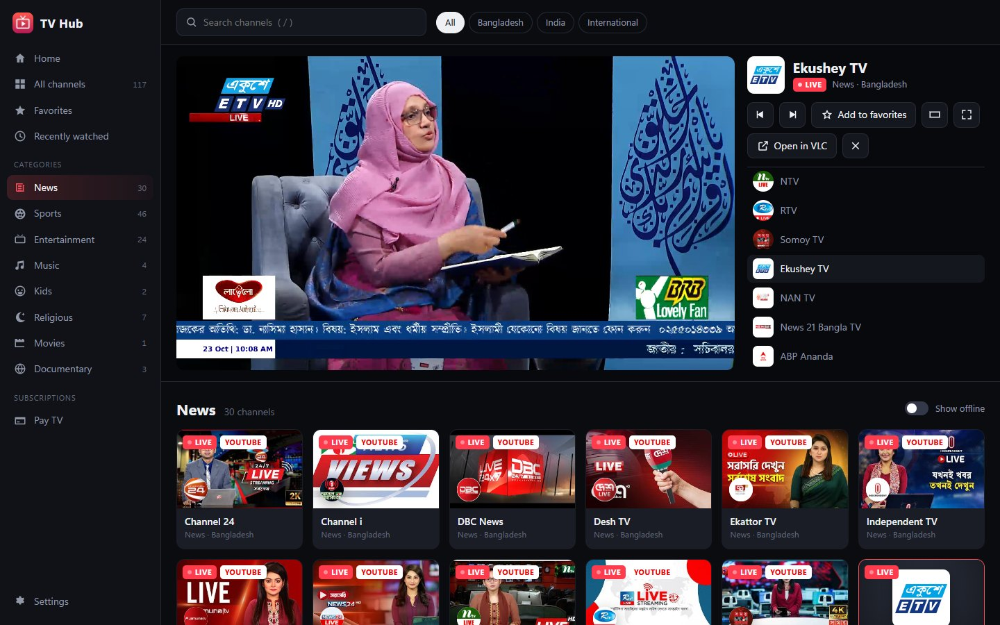
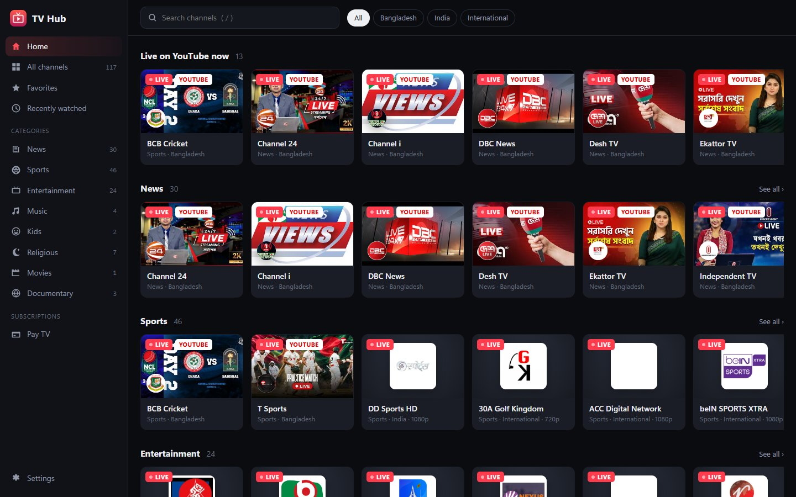
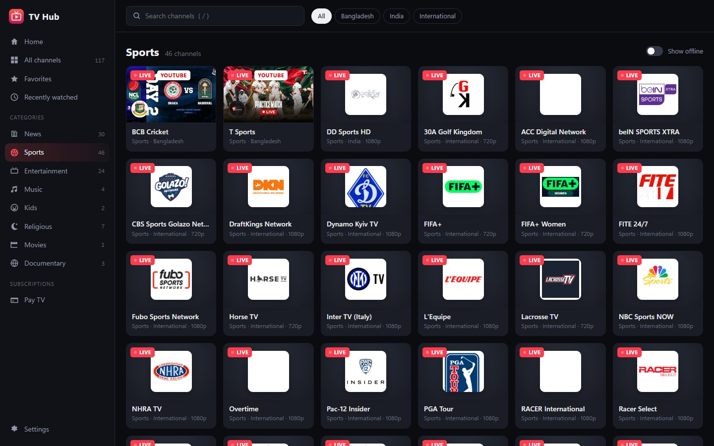
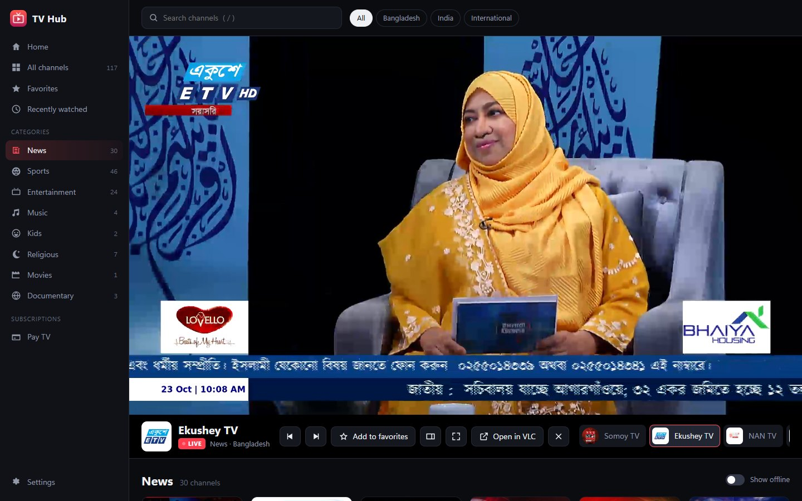
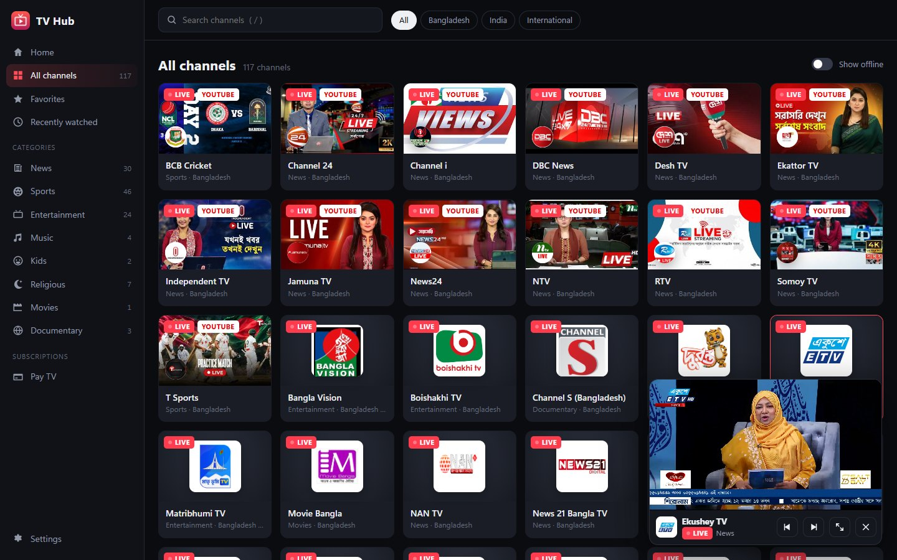
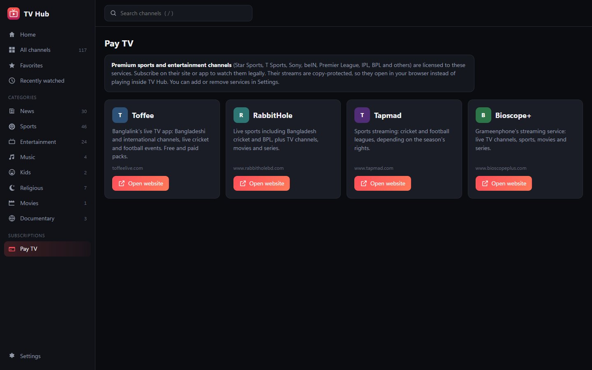
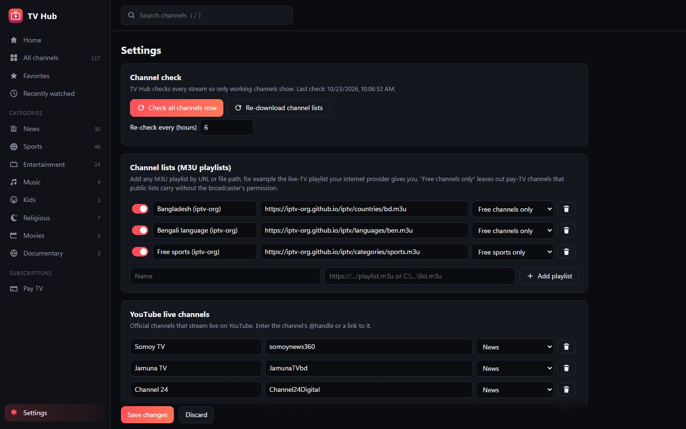
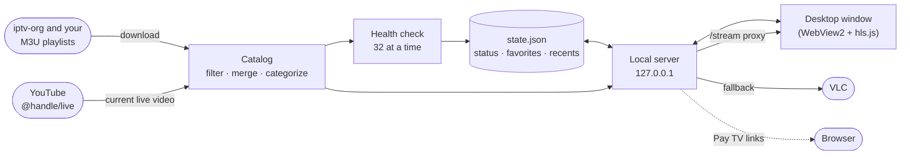

<div align="center">


# TV Hub

**Live Bangladeshi, Bengali and free sports TV in one window, showing only channels that are on air.**

TV Hub gathers channels from public M3U playlists and the official YouTube
live streams of Bangladeshi broadcasters, checks every stream on a schedule,
and plays them right inside the app, with a YouTube-style mini player.




</div>

---

## Why TV Hub?

Public IPTV playlists list hundreds of channels, but many of the links are
dead, and some are pay-TV channels rebroadcast without permission. YouTube has
most Bangladeshi news channels live, but you have to hunt for each channel's
current stream. TV Hub combines both and cleans the list up:

- 📡 **Only what's on air.** Every stream is checked in the background, and
  dead channels are hidden. On a typical day about **120 of 150** channels
  are live.
- 📺 **Bangladeshi TV in one place.** You get Somoy, Jamuna, Channel 24,
  Ekattor, DBC, NTV, RTV, Channel i, Desh TV and more, plus Bengali channels
  from India.
- ⚽ **Free sports, legally.** FIFA+, Red Bull TV, DD Sports, beIN SPORTS XTRA,
  CBS Sports Golazo and Real Madrid TV are included, plus T Sports, BCB, ICC
  and FIFA whenever they're live on YouTube.
- 🚫 **No pirated pay TV.** Pay-TV channels are filtered out of public lists.
  Paid services get their own page that opens their official site.

## Features

<table>
<tr>
<td width="50%" valign="top">

### 📺 Channels
- **iptv-org** Bangladesh and Bengali playlists, filtered to *free channels only*
- **Free sports** playlist with an allowlist of free and official channels
- **21 official YouTube live channels**, looked up without an API key
- **8 categories**: News, Sports, Entertainment, Music, Kids, Religious,
  Movies, Documentary
- **Region chips**: Bangladesh, India, International
- Duplicates merged into one channel, with its other links kept as backups

</td>
<td width="50%" valign="top">

### ▶️ Player
- Plays HLS streams and YouTube live **inside the window**
- **Theater mode**, **full screen**, and a corner **mini player**
- Drag to resize the player, and the size is remembered
- Previous and next channel, with a channel strip under the video
- Backup links are tried in turn when a stream fails
- **Open in VLC** for anything the window can't decode

</td>
</tr>
<tr>
<td valign="top">

### 📡 Health checks
- Every stream is checked on a schedule (every 6 hours by default)
- Master playlists are checked down to their first variant, so stale links
  are caught
- Live and offline status on every card, plus a **Show offline** switch
- Live channel counts in the sidebar
- **Check all channels now** and **Re-download channel lists** in Settings

</td>
<td valign="top">

### ⭐ Yours
- **Favorites** and **Recently watched**, plus *Continue watching* on Home
- **Add your own**: any M3U playlist (for example your ISP's), single stream
  links, or YouTube channels
- **Pay TV** page linking to Toffee, RabbitHole, Tapmad and Bioscope+
- Keyboard channel surfing with ↑ / ↓
- Search channels from anywhere with **/**

</td>
</tr>
</table>

## Screenshots

<table>
<tr>
<td width="50%"><p align="center"><b>Home:</b> live on YouTube now, then a row per category</p></td>
<td width="50%"><p align="center"><b>Sports:</b> free and official sports channels only</p></td>
</tr>
<tr>
<td><p align="center"><b>Theater mode:</b> full-width video with a channel strip</p></td>
<td><p align="center"><b>Mini player:</b> keeps playing while you browse</p></td>
</tr>
<tr>
<td><p align="center"><b>Pay TV:</b> official subscription services, opened in the browser</p></td>
<td><p align="center"><b>Settings:</b> playlists, YouTube channels, check schedule</p></td>
</tr>
</table>

## Getting started

### Requirements

| | |
|---|---|
| **OS** | Windows 10 or 11 (the window uses Microsoft Edge WebView2, which Windows 11 already has) |
| **Player** *(optional)* | [VLC](https://www.videolan.org/vlc/), for streams the window can't decode |
| **To build** | [Rust](https://rustup.rs) (stable) and the MSVC Build Tools (the C++ workload) |

### Build and run

```powershell
git clone https://github.com/coderasraf/tv-hub.git
cd tv-hub
cargo build --release
.\target\release\tv-hub.exe
```

The build produces two programs:

| File | What it is |
|---|---|
| `tv-hub.exe` | the desktop app |
| `tvhub.exe` | the command-line tool (`tvhub serve`, `tvhub check --verbose`) |

> [!NOTE]
> If you install the app as `%LOCALAPPDATA%\Programs\TVHub\TVHub.exe`, copy
> the CLI next to it as **`tvhub-cli.exe`**. Windows file names ignore case,
> so `tvhub.exe` would overwrite `TVHub.exe`.

> [!NOTE]
> If the build fails with *"An Application Control policy has blocked this
> file (os error 4551)"*, Windows **Smart App Control** is blocking the build
> scripts that cargo compiles. Build with Smart App Control turned off, or
> under WSL.

### First run

1. Start the app. It downloads the channel lists and checks every stream,
   which takes about a minute. A progress pill at the top shows how far it
   has got, and channels appear as soon as they pass.
2. Click any channel card to play it. Use **↑ / ↓** to flip through channels,
   **T** for theater mode and **F** for full screen.
3. Click **Add to favorites** on channels you watch often. They show up on
   Home and under **Favorites**.
4. *(Optional)* **Settings → Channel lists:** add your internet provider's M3U
   playlist, or a local `.m3u` file. Use **My channels** for single stream
   links and **YouTube live channels** for any channel's `@handle`.

| What | Where |
|---|---|
| Settings | `%APPDATA%\TVHub\config.toml` |
| Favorites, recents, check results | `%APPDATA%\TVHub\state.json` |
| Downloaded playlists | `%APPDATA%\TVHub\playlists\` |
| Window profile | `%APPDATA%\TVHub\` (WebView data) |

## Player size

- **Default view:** the video fills the width beside the channel list and stays
  pinned while you browse. Drag the player's bottom edge to resize it, or
  double-click the edge to fit it to the window again. The size is remembered.
- **Theater mode:** the video spans the full width, with the controls and a
  channel strip underneath. If you scroll down to browse, the video keeps
  playing in a corner mini player.
- **Full screen:** fills the whole screen.
- **Mini player:** when you open another page or search while a channel plays,
  the video shrinks into the bottom-right corner, YouTube style, and the page
  gets the whole window. The mini player has previous and next channel,
  expand and close buttons. Clicking a channel card, the mini player's title
  or the expand button brings back the full player. Playback never restarts
  when the player changes size.

## Keyboard shortcuts

| Key | Action |
|---|---|
| **↑ / ↓** or **PgUp / PgDn** | Previous / next channel |
| **← / →** | Volume |
| **F** or double-click | Full screen |
| **T** | Theater mode (scrolling down turns it into a mini player) |
| **M** | Mute |
| **Space** | Pause |
| **/** | Search |
| **Esc** | Leave full screen |

## Where the channels come from

TV Hub doesn't host or rebroadcast anything. Every stream plays straight from
its publisher.

| Source | What it adds | Filter |
|---|---|---|
| [iptv-org](https://github.com/iptv-org/iptv) `countries/bd.m3u` | Bangladeshi channels | *Free channels only*: drops pay-TV brands |
| [iptv-org](https://github.com/iptv-org/iptv) `languages/ben.m3u` | Bengali channels from India and elsewhere | *Free channels only* |
| [iptv-org](https://github.com/iptv-org/iptv) `categories/sports.m3u` | FIFA+, Red Bull TV, DD Sports, beIN SPORTS XTRA, … | *Free sports only*: an allowlist |
| Official **YouTube** channels | Somoy, Jamuna, Channel 24, Ekattor, DBC, ATN News, NTV, RTV, BTV News, T Sports, BCB, ICC, FIFA, … | Shown only while they're live |
| **Your own** playlists and links | Anything you add in Settings | None, unless you choose one |

Premium channels such as Star Sports, Sony, T Sports' TV feed, the Premier
League, IPL and BPL are licensed to paid services. Public playlists that carry
them are rebroadcasting them without permission, so TV Hub leaves them out.
The **Pay TV** page links to the official services instead.

## How it works



- **Checked, not guessed.** A stream passes if its playlist downloads and
  parses. For a master playlist, the first variant is fetched too, because
  dead channels often keep serving a stale master whose variants are gone.
- **YouTube without an API key.** `youtube.com/@handle/live` serves the live
  video's page while a channel is on air and the channel page otherwise. TV
  Hub reads the canonical link to tell the two apart.
- **A local proxy for picky streams.** Most IPTV servers send no CORS headers,
  and some need a particular User-Agent or Referer. The window plays streams
  through `/stream`, which adds those headers and rewrites HLS playlists so
  every segment goes through it too. Each proxied URL carries a keyed hash, so
  the proxy only fetches links the app itself handed out.
- **Local and private.** The server listens only on `127.0.0.1`. There is no
  account and no analytics, and nothing is uploaded.

## Command-line tool

```powershell
tvhub check             # download the playlists, check every channel, print a summary
tvhub check --verbose   # also list each channel as LIVE or ----
tvhub serve --port 8090 # the full app UI in your browser
```

## Project layout

```text
src/
├── desktop.rs   desktop window (wry + tao on WebView2)
├── main.rs      command-line tool (clap)
├── web.rs       local API + UI server (axum, loopback only), scheduled checks
├── ui/          the app's interface: HTML, CSS, plain JavaScript and hls.js
├── catalog.rs   playlists + YouTube + your channels → one curated channel list
├── m3u.rs       M3U / iptv-org playlist parser (quality, tags, headers)
├── health.rs    concurrent stream checks, down to the first HLS variant
├── youtube.rs   finds a channel's current live video without an API key
├── proxy.rs     signed local stream proxy with HLS playlist rewriting
├── store.rs     favorites, recents, volume and check results
├── config.rs    settings, built-in playlists, YouTube channels, Pay TV services
└── player.rs    safe hand-off to VLC and the browser
```

Run the tests with `cargo test`. The app icon is generated by
`assets/make_icon.py` (needs Pillow).

## Troubleshooting

<details>
<summary><b>A channel shows as live but won't play</b></summary>

Streams can go down between checks. TV Hub tries each of the channel's backup
links in turn, then offers **Open in VLC**. Run **Settings → Check all
channels now** to refresh the list.
</details>

<details>
<summary><b>"player not found" when opening in VLC</b></summary>

Set the path to `vlc.exe` in **Settings → External player**. It's usually at
`C:\Program Files\VideoLAN\VLC\vlc.exe`.
</details>

<details>
<summary><b>A YouTube channel is missing</b></summary>

YouTube channels only appear while they're streaming live. News channels are
live most of the day. Sports channels such as T Sports, BCB and ICC go live
for matches.
</details>

<details>
<summary><b>Where are Star Sports, T Sports (TV), Sony or Zee?</b></summary>

Those are pay-TV channels, licensed to services such as Toffee, RabbitHole,
Tapmad and Bioscope+. Their streams are DRM-protected and only play in their
own app or site, so TV Hub links to them from the **Pay TV** page.
</details>

## Roadmap

- [ ] Prebuilt Windows installer on the Releases page
- [ ] EPG: what's on now and next, from XMLTV guides
- [ ] Picture-in-picture outside the app window
- [ ] Recording a live stream to a file
- [ ] macOS and Linux builds

## Acknowledgements

Built with [axum](https://github.com/tokio-rs/axum),
[reqwest](https://github.com/seanmonstar/reqwest),
[wry and tao](https://github.com/tauri-apps/wry),
[clap](https://github.com/clap-rs/clap),
[regex](https://github.com/rust-lang/regex),
[rfd](https://github.com/PolyMeilex/rfd) and
[hls.js](https://github.com/video-dev/hls.js).

Channel lists come from the community-maintained
[iptv-org](https://github.com/iptv-org/iptv) project. TV Hub is not affiliated
with iptv-org, YouTube, or any broadcaster or streaming service named here.

> [!IMPORTANT]
> TV Hub is a player, not a source of content. All channels belong to their
> broadcasters and stream straight from them. Use only playlists and streams
> you are allowed to watch.
